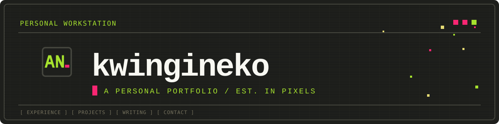

# Kwingineko

Kwingineko is Aatir Nadim’s personal portfolio, presented as a small retro-inspired workstation. Explore his experience, selected software projects, technical interests, writing, and certificates through a starfield of pixel art, computer panels, and playful details.

## What’s on the site

-  **Portfolio:** an introduction, résumé, work experience, selected projects, areas of expertise, writing, certificates, FAQ, and contact options. 
-  **Reading Radio:** choose up to three topics for a personal RSS reading mix. Browse topics such as AI, anime, cinema, open source, gaming, and more; the selected mix stays in your browser. 
-  **Fortune cookie:** crack a pixel-art cookie for a fortune, lucky number, and lucky hex color. The little crack sound can be turned off. 
-  **Workstation cat:** pet the cat, feed it when it gets hungry, or let it follow your cursor. It may meow when it wants attention. 
-  **Recreation Bay:** boot classic DOS games in the browser from Aatir’s Arcade inside FAQ & Trivia. 
-  **More desk details:** local weather, a living starfield, an interactive particle portrait, CRT scanlines, and a command palette. 

## A few hints

- Try **Cmd/Ctrl+K** or **/** to open the command palette.
- The workstation has a developer-console welcome message with a hint to its commands.
- There’s a classic game-code sequence hidden in the experience. The console can reveal it.
- Keep an eye out for a lost swordsman and other small details around the page.

For local setup, project structure, implementation details, configuration, and deployment notes, see the [Technical README](TECHNICAL_README.md).
